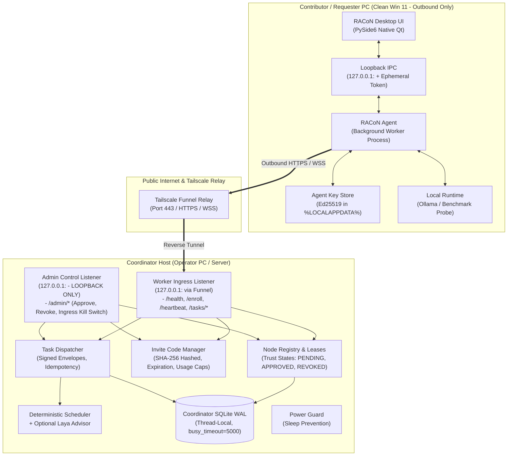

# RACoN — Detailed System Architecture

**Document version:** 2.0  
**Target baseline:** RACoN Production Desktop with Tailscale Funnel Coordinator  
**Project direction:** Local-first scheduler prototype → private multi-computer compute cluster → production desktop product  
**Primary development environment:** Windows 11, Python 3.12, PySide6, SQLite WAL, Laya decision engine, Tailscale Funnel  

---

## 1. Executive Summary

RACoN (Resource-Aware Collaborative Network) coordinates compute resources across computers so supported AI workloads can be scheduled across heterogeneous machines.
The platform operates as a secure **hub-and-spoke distributed network**:
- **Coordinator Host (Hub):** Sits behind Tailscale Funnel on port 443. Runs the deterministic multi-objective scheduler, optional Laya decision engine, node registry, task queue, and SQLite WAL database.
- **Contributor / Requester PCs (Spokes):** Clean Windows 11 PCs running the native PySide6 desktop UI and a background worker agent. Makes **only outbound** HTTPS/WSS connections. No inbound ports, no Funnel, and no router configuration required.

### Core Architecture Principles
1. **Deterministic Safety Invariant:** The deterministic scheduler enforces correctness and hard constraints. Laya advises strictly among pre-filtered feasible candidates (ADR-002).
2. **Dual Listeners:** Worker control routes are published through Funnel on `127.0.0.1:<worker-port>`; administrative controls are bound strictly to a loopback-only port and **never** exposed to Funnel (ADR-006).
3. **Control-Plane Funnel Scope:** Tailscale Funnel carries control-plane traffic only (< 64 KB) and small task results (< 256 KB). Model weights and activation tensors must **never** traverse Funnel (ADR-007, ADR-012).
4. **Zero Arbitrary Code Execution:** Worker agents execute only allow-listed, structured task types (`TEXT_COMPLETION`, `BENCHMARK_PROBE`, `EMBEDDING`). No shell execution, `eval()`, or unpickling of Python objects.
5. **Decoupled Agent Lifecycle:** The worker agent runs as an independent process with authenticated loopback IPC to the PySide6 UI (ADR-010).

---

## 2. Product Scope & Execution Modes

Every task and result carries an explicit mode tag shown in the UI:
- **`SIMULATED` (`SIM-`):** Synthetic candidates from JSON scenarios for lab testing.
- **`LOCAL`:** Workload executed locally on the requester's own machine.
- **`REMOTE_SINGLE_WORKER`:** Whole task placed on the best feasible authenticated remote worker over the control channel.
- **`DISTRIBUTED_PIPELINE`:** Split-layer model execution crossing machines. **Restricted to high-speed private LAN only (never Funnel).** Multiple machines are never described as "one pooled RAM/VRAM space".

---

## 3. High-Level System Topology



---

## 4. Component Layout

```
racon/
├── __init__.py
├── __main__.py               # Entrypoint: python -m racon
├── app.py                    # Application bootstrap
├── agent/                    # Decoupled Worker Agent
│   ├── __init__.py
│   ├── crypto_store.py       # Ed25519 identity storage in AppData
│   ├── worker.py             # Heartbeat, task claim & allow-listed execution
│   └── ipc.py                # Loopback IPC server with ephemeral token
├── coordinator/              # Coordinator Hub Services
│   ├── __init__.py
│   ├── registry.py           # Node registry & trust state machine
│   ├── invites.py            # SHA-256 hashed invite code manager
│   ├── tasks.py              # Signed task envelopes & idempotency cache
│   ├── ingress.py            # PublicIngress port & Tailscale Funnel adapter
│   ├── server.py             # Dual listeners (Worker API vs Admin API)
│   └── power_guard.py        # Windows AC standby detection & sleep prevention
├── core/
│   ├── __init__.py
│   ├── config.py             # Layered configuration & endpoint resolution
│   └── update_manifest.py    # Signed update manifest validation
├── hardware.py               # Hardware discovery (CPU/RAM/safe GPU fallback)
├── scheduler/
│   ├── deterministic.py      # Hard constraints & multi-objective placement
│   ├── laya_adapter.py       # Official Laya typed-decisions router (lazy loaded)
│   ├── evaluation.py         # Deterministic, Shadow, and Assisted engine
│   └── models.py             # CandidateEvaluation, SchedulerResult
├── storage/
│   ├── database.py           # SQLite WAL connection manager (busy_timeout=5000)
│   ├── repository.py         # Serialized write transactions
│   └── models.py             # AuditEvent, BenchmarkRecord
├── scenarios/
│   ├── loader.py             # Bundle-safe scenario loader
│   └── sample_scenarios.json # Explicitly simulated candidate scenarios
└── ui/
    ├── main_window.py        # QMainWindow with QTabWidget navigation
    ├── dashboard.py          # Real-time hardware telemetry display
    ├── worker_panel.py       # Live worker state, enrollment, and controls
    ├── scheduler_lab.py      # Interactive scenario testing
    ├── benchmark_history.py  # Benchmark records & decision logs
    └── settings.py           # Resource ceilings & Laya controls

protocols/                    # Shared Typed Versioned Protocol Package
├── __init__.py
├── crypto.py                 # Ed25519 keypairs, signing, verification, SHA-256
└── models.py                 # Pydantic v2 schemas for all network messages
```

---

## 5. Architectural Decision Records (ADRs) Summary

- **ADR-001**: Native PySide6 Desktop Application
- **ADR-002**: Deterministic Safety Invariant with Laya Advisory
- **ADR-003**: Thread-Safe SQLite WAL Concurrency
- **ADR-004**: Lazy Laya Initialization
- **ADR-005**: Hub-and-Spoke Topology via Coordinator Funnel Ingress
- **ADR-006**: Dual Listeners on Coordinator (Public Worker API vs. Loopback Admin API)
- **ADR-007**: Funnel Scope Limited to Control-Plane Traffic and Small Payloads
- **ADR-008**: Public Ingress Port Abstraction (`PublicIngress`)
- **ADR-009**: Invite-Only Enrollment with Mandatory Operator Approval
- **ADR-010**: Decoupled Worker Agent Process with Authenticated Loopback IPC
- **ADR-011**: Configurable Coordinator Endpoint Resolution
- **ADR-012**: Distributed Pipeline Inference Boundary & Private LAN Restriction
- **ADR-013**: Windows Per-User Installer Packaging via Inno Setup
