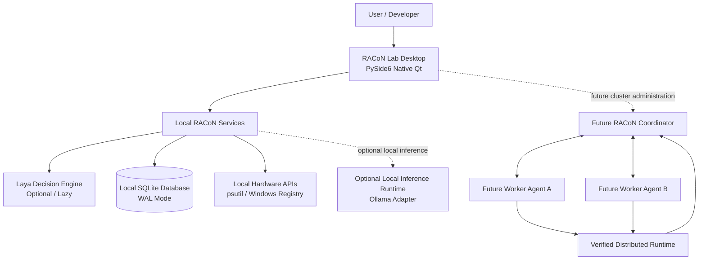

# RACoN — Detailed System Architecture

**Document version:** 1.0  
**Target baseline:** RACoN Lab v0.1.0  
**Project direction:** Local-first scheduler prototype → private multi-computer compute cluster → production desktop application  
**Primary development environment:** Windows 11, Python, PySide6, SQLite, optional Laya decision engine  

---

## 1. Executive Summary

RACoN (Resource-Aware Collaborative Network) coordinates compute resources across computers so supported AI workloads can be scheduled across heterogeneous machines. The RACoN Lab v0.1.0 application provides the verified local foundation:
1. Real local hardware discovery (accurate CPU, RAM, process RSS; non-fabrication of GPU metrics for integrated Intel UHD 630).
2. Deterministic candidate evaluation with hard feasibility constraints and multi-objective scoring.
3. Optional Laya-assisted scheduling using the official typed decision engine (`typed-decisions`).
4. Simulated worker scenarios explicitly labeled (`is_simulated=True`, `SIM-`).
5. Native PySide6 Qt desktop interface (Dashboard, Scheduler Lab, History, Settings).
6. SQLite WAL persistence with thread-safe connections, busy timeouts, and serialized writes.

### Core Architecture Principle
**The deterministic scheduler enforces correctness; Laya may advise among candidates that have already passed hard validation.** Laya is not the inference runtime, not the worker registry, and not a security boundary. It must never be allowed to choose an infeasible placement.

---

## 2. Product Scope by Version

| Capability | RACoN Lab v0.1 | Next Milestone | Future RACoN |
|---|---|---|---|
| Desktop UI | Native PySide6 (Qt) | Improve reliability & packaging | Retain PySide6 modular monolith |
| Hardware discovery | Real local CPU/RAM; safe GPU handling | Capability snapshots and freshness | Worker-side telemetry on each participating PC |
| Scheduler | Deterministic + Laya Advisor | Live worker registry and reservations | Resource-aware placement across actual nodes |
| Laya | Optional local decision adapter (`typed-decisions`) | Verified live decisions & benchmark vs baseline | Optional advisor; deterministic fallback always available |
| Worker candidates | Scenario JSON, explicitly simulated | One real local worker service; private LAN registration | Multiple authenticated workers |
| Inference | Not implemented as distributed execution | Verified local runtime adapter (Ollama) | Real distributed model execution through a verified runtime |
| Persistence | Local SQLite WAL with thread-local pooling | Migrations, backup/restore tests | Coordinator-owned metadata; local node state |
| Networking | None required (local desktop) | Private network only | Authenticated, encrypted worker protocol |
| Desktop installer | Development launch first | Reproducible standalone PyInstaller / Inno Setup | Versioned releases, upgrade & rollback support |

---

## 3. System Context



In v0.1, the operational scope is strictly the desktop, local services, Laya adapter, local hardware monitoring, and SQLite.

---

## 4. Architectural Style: Modular Monolith

RACoN Lab is organized as a **modular monolith** with clean package boundaries:

```
racon/
├── __init__.py
├── __main__.py               # Entrypoint: python -m racon
├── app.py                    # Application bootstrap & lifecycle
├── hardware/
│   ├── __init__.py
│   ├── discovery.py          # Real CPU, RAM, GPU detection
│   └── models.py             # HardwareSnapshot, GpuInfo
├── scheduler/
│   ├── __init__.py
│   ├── models.py             # WorkerCandidate, CandidateEvaluation, SchedulerResult
│   ├── deterministic.py      # Hard validation & multi-objective scoring
│   ├── laya_adapter.py       # Official Laya Router integration (lazy loaded)
│   └── evaluation.py         # SchedulingEngine (Deterministic, Shadow, Assisted)
├── services/
│   ├── __init__.py
│   ├── hardware_service.py   # Background telemetry poller (QThread)
│   └── benchmark_service.py  # Background benchmark worker (QThread) with graceful cancel
├── storage/
│   ├── __init__.py
│   ├── database.py           # Thread-local SQLite connection manager (WAL, busy_timeout=5000)
│   ├── repository.py         # Thread-safe repository with write_lock
│   └── models.py             # AuditEvent, BenchmarkRecord, SchedulerDecisionRecord
├── scenarios/
│   ├── __init__.py
│   ├── loader.py             # Bundle-safe scenario loader
│   └── sample_scenarios.json # Standard evaluation scenarios
└── ui/
    ├── __init__.py
    ├── main_window.py        # QMainWindow with QTabWidget navigation & graceful closeEvent
    ├── dashboard_view.py     # Real-time hardware telemetry display
    ├── lab_view.py           # Interactive scheduler testing and candidate inspection
    ├── history_view.py       # Benchmark history & decision log tables
    ├── settings_view.py      # Configurable resource limits & Laya controls
    └── components/
        └── card.py           # Reusable styled UI card widgets
```

---

## 5. Architectural Decision Records (ADRs)

### ADR-001: Native PySide6 Desktop Application
- **Decision:** Keep the native PySide6 (Qt) modular monolith rather than Tauri/React.
- **Rationale:** Avoids unnecessary multi-process overhead, inter-process serialization, and webview dependencies for a local-first computing tool. PySide6 provides direct native access to hardware threads and Python libraries without IPC complexity.

### ADR-002: Deterministic Safety Invariant with Laya Advisory
- **Decision:** All candidates must pass strict deterministic hard-constraint validation (RAM, device type, online status, busy check) before scoring.
- **Rationale:** Neural or heuristic decision engines like Laya must never be allowed to select an infeasible worker. Laya serves purely as an advisor among pre-filtered feasible candidates. If Laya fails, times out, or selects an invalid candidate, the engine safely falls back to the deterministic best choice.

### ADR-003: Thread-Safe SQLite WAL Concurrency
- **Decision:** SQLite connections are isolated per-thread using `threading.local()` with `PRAGMA busy_timeout=5000` and `PRAGMA journal_mode=WAL`. Write operations are serialized via a threading mutex.
- **Rationale:** Prevents `sqlite3.ProgrammingError: SQLite objects created in a thread can only be used in that same thread` when background QThreads record benchmark runs.

### ADR-004: Lazy Laya Initialization
- **Decision:** The Laya `Router` is never loaded on application startup. It initializes on demand only when the user explicitly triggers a Laya-assisted or Shadow scheduling evaluation.
- **Rationale:** Preserves system RAM (~1.8 GB memory footprint on CPU) and keeps initial application launch instantaneous on modest hardware (Intel Core i3 / 16GB RAM).
